# Animal Detection for Smart Agriculture

**CV concept:** Object detection (bounding boxes + class labels) with transfer learning.

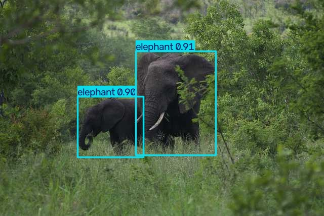

## Problem Statement
Large animals entering farmland or grazing areas destroy crops, injure livestock and put farmers at risk.
Watching camera feeds by hand all day is not practical, so farms need a system that can automatically find
and identify animals in camera images.

## Objective
Train an object detector that locates and classifies four large animals (**buffalo, elephant, rhino, zebra**)
in real-world outdoor images with high precision and recall, and fast enough to run in real time on a camera feed.

## Dataset
| | |
|---|---|
| Name | African Wildlife Dataset |
| Link | https://docs.ultralytics.com/datasets/detect/african-wildlife/ |
| Classes | buffalo, elephant, rhino, zebra |
| Format | YOLO (one `.txt` per image: `class x_center y_center width height`, normalised) |
| Split | train 1052 images · val 225 · test 227 |
| Download | automatic on first run of `src/main.py` |

Boxes per class in the training split (fairly balanced, zebra most common):

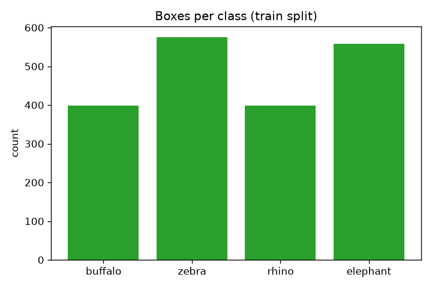

## Methodology
1. **Dataset analysis** — count images and boxes per class for every split (`analyse_dataset`).
2. **Preprocessing** — images letterboxed to 640×640 and normalised to [0, 1].
   **Augmentation** during training: mosaic, random horizontal flip, HSV colour jitter, scale/translate.
3. **Model** — YOLO11n (2.6 M parameters), pretrained on COCO and fine-tuned on this dataset (transfer learning).
   YOLO is a one-stage detector: a CNN backbone extracts features, a neck mixes them at 3 scales and the
   head directly predicts boxes and class scores, followed by Non-Maximum Suppression (NMS).
4. **Training** — 50 epochs, batch 16, image size 640, SGD/AdamW auto-selected, seed 0.
5. **Evaluation** — best checkpoint (highest val mAP) evaluated on the held-out **test** split.

## Tools / Libraries Used
Python 3.11, PyTorch 2.11 (CUDA 12.8), Ultralytics YOLO11, Matplotlib. GPU: RTX 5080 Laptop.

## Results

### Performance evaluation (test split, 227 images)
| Metric | Value |
|---|---|
| Precision | **0.963** |
| Recall | **0.935** |
| mAP@0.5 | **0.971** |
| mAP@0.5:0.95 | **0.828** |
| Inference speed | 2.5 ms / image (~400 FPS) |

| Class | mAP@0.5:0.95 |
|---|---|
| buffalo | 0.841 |
| elephant | 0.774 |
| rhino | 0.913 |
| zebra | 0.785 |

*Metrics:* precision = correct detections / all detections; recall = found animals / all animals;
mAP = area under the precision-recall curve averaged over classes, at IoU 0.5 and averaged over IoU 0.5–0.95.

| Training curves | Confusion matrix |
|---|---|
| 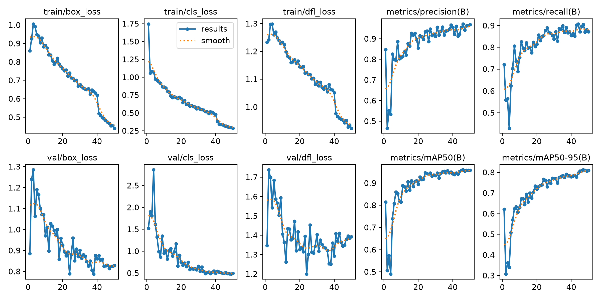 | 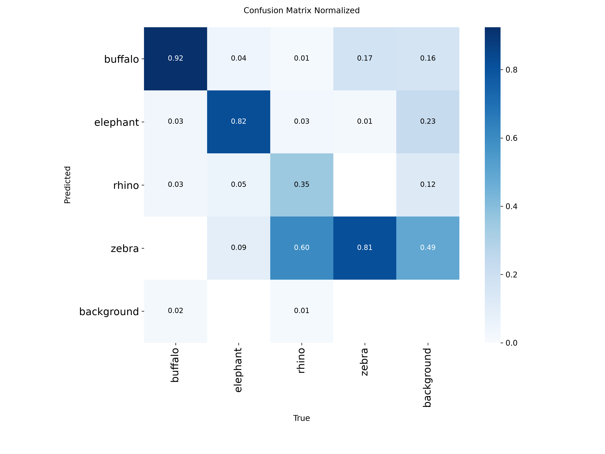 |

| Precision–Recall curve | F1 curve |
|---|---|
| 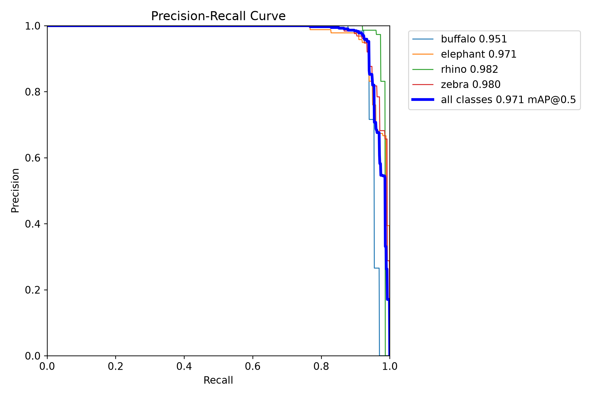 | 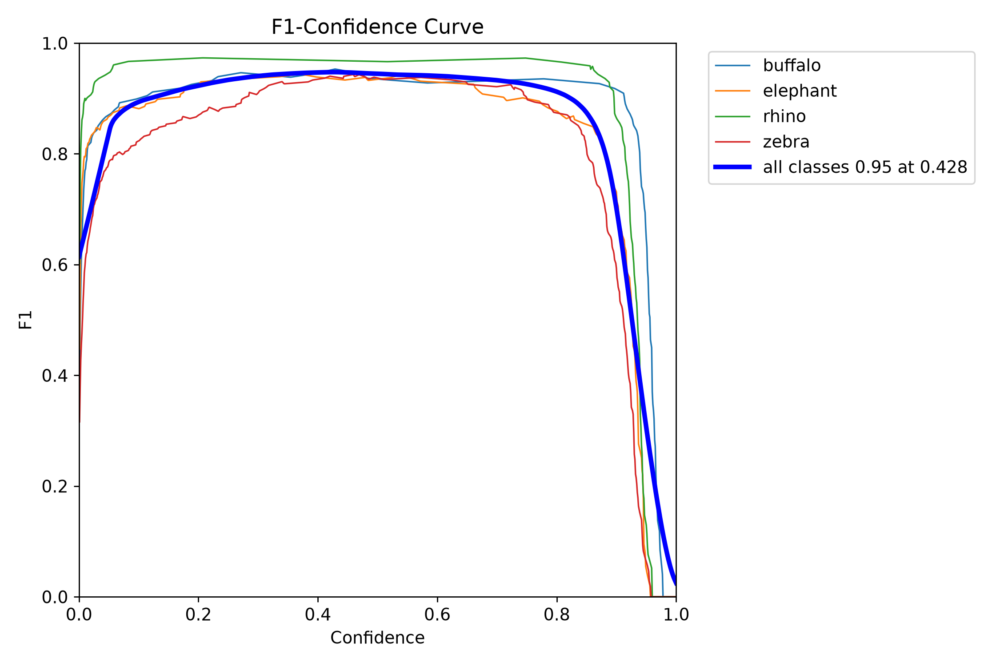 |

### Sample input → output
| | | | |
|---|---|---|---|
| 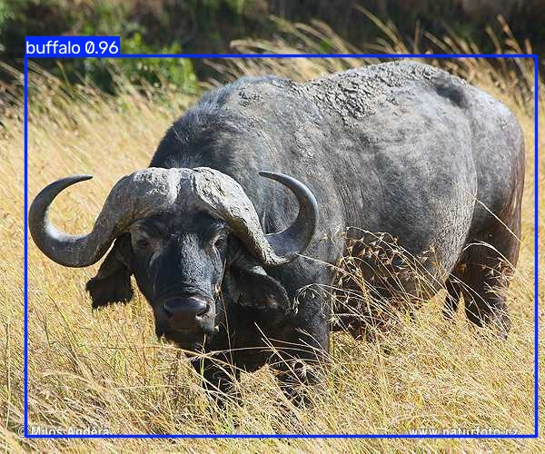 | 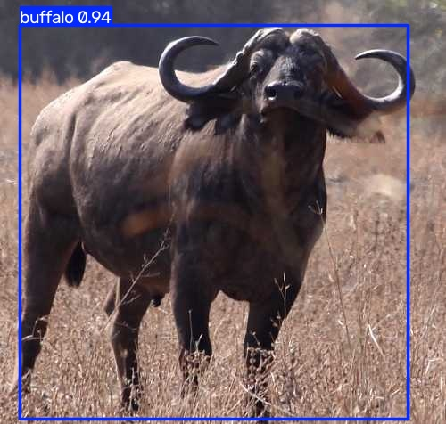 | 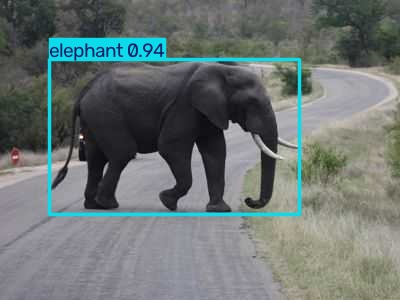 | 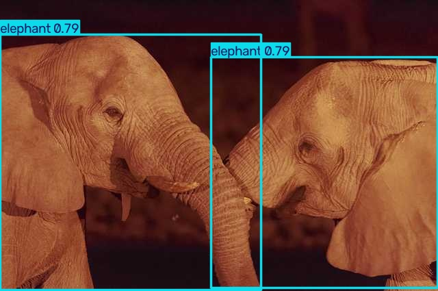 |
| 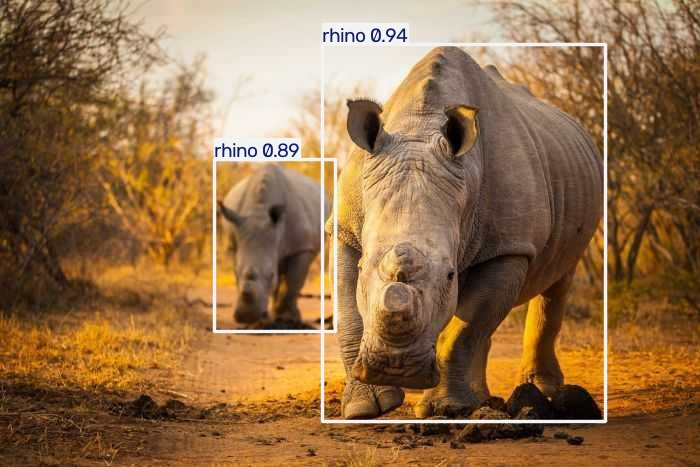 | 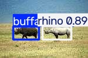 | 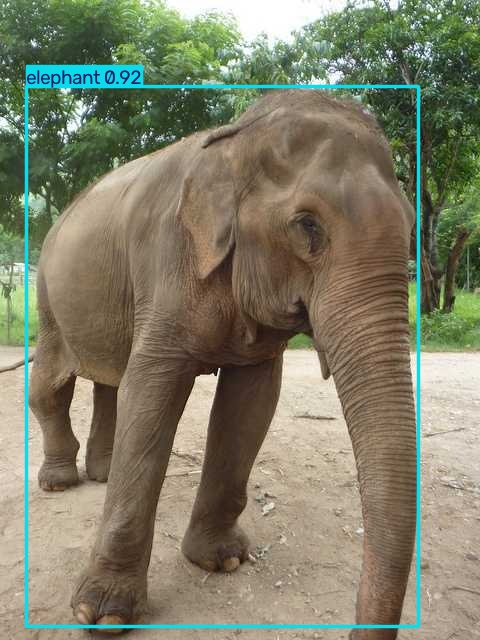 |  |

Augmented training batch (what the network actually sees): [train_batch0.jpg](results/train_batch0.jpg)

## Limitations / Challenges
- Elephant and zebra have the lowest mAP@0.5:0.95 — herds overlap heavily, so boxes for animals behind
  others are less precise.
- Only 4 species and daytime savanna images; a real farm needs night/IR images, other animals (deer, boar,
  cattle, dogs) and local backgrounds.
- 1052 training images is small; the model relies on COCO pretraining.
- Test images come from the same source as training images, so real-camera performance will be lower.

## Conclusion
A small YOLO11n model fine-tuned for 50 epochs reaches **0.97 mAP@0.5** and **0.83 mAP@0.5:0.95** on unseen
test images while running at ~400 FPS, which is accurate and fast enough for real-time farm monitoring.
Extending the dataset with local species and night images is the main step towards deployment.

## How to run
```bash
pip install -r requirements.txt
python src/main.py          # downloads data, trains, evaluates, writes results/
```
See [report.md](report.md) for the brief project report.
