# Industrial Defect Detection System — Surface Crack Segmentation

**CV concept:** Instance segmentation (pixel-level mask for every object), used for visual defect inspection.

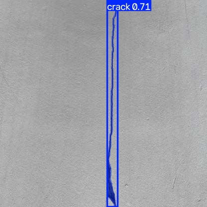

## Problem Statement
Cracks in concrete, walls and road surfaces are early signs of structural damage in buildings, bridges,
factories and roads. Manual inspection is slow, subjective and sometimes dangerous. A box around a crack is not
enough to judge severity — inspectors need the **exact shape and size** of the damage.

## Objective
Train a model that finds every crack in an image and outlines it **pixel by pixel**, then use the mask to
estimate how much of the surface is damaged (a simple severity measure).

## Dataset
| | |
|---|---|
| Name | Crack Segmentation Dataset (Roboflow / Ultralytics) |
| Link | https://docs.ultralytics.com/datasets/segment/crack-seg/ |
| Content | concrete, wall and road surfaces with cracks, under different lighting and textures |
| Classes | 1 (`crack`) |
| Format | YOLO segmentation (`class x1 y1 x2 y2 …` normalised polygon per crack) |
| Split | train 3717 images (4893 cracks) · val 200 (249) · test 112 (148) |
| Download | automatic on first run of `src/main.py` |

Cracks are **thin and small**: the median crack polygon covers only **1.1 % of the image**.

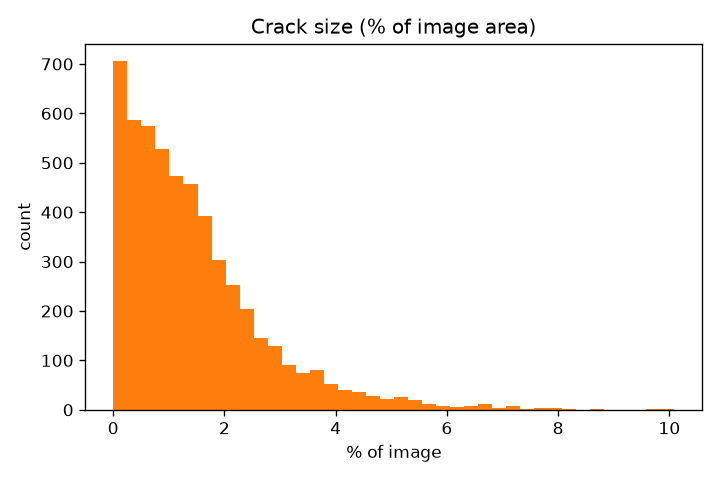

## Methodology
1. **Dataset analysis** — count images/cracks per split and compute each crack's area from its polygon with the
   shoelace formula (`polygon_area`, `analyse_dataset`).
2. **Preprocessing** — images letterboxed to 640×640 and normalised; polygons converted to binary masks by the
   data loader. **Augmentation:** mosaic, flips, HSV jitter, scale/translate.
3. **Model** — YOLO11n-seg (COCO-pretrained, fine-tuned). Like a detector it predicts boxes + classes, and an
   extra branch predicts a set of *prototype masks* plus per-object coefficients; their combination gives each
   object's mask (YOLACT-style).
4. **Training** — 50 epochs, batch 16, image size 640, seed 0 (~18 min on RTX 5080 Laptop).
5. **Evaluation** — best checkpoint on the held-out **test** split; box and mask precision/recall/mAP.
6. **Severity estimate** — fraction of image pixels covered by predicted crack masks.

## Tools / Libraries Used
Python 3.11, PyTorch 2.11, Ultralytics YOLO11-seg, NumPy, Matplotlib.

## Results

### Performance evaluation (test split, 112 images)
| Metric | Box | Mask |
|---|---|---|
| Precision | 0.721 | 0.716 |
| Recall | 0.662 | 0.608 |
| mAP@0.5 | **0.725** | **0.630** |
| mAP@0.5:0.95 | 0.532 | 0.217 |

Inference speed: **1.8 ms / image**.

**Why is mask mAP@0.5:0.95 low?** A crack is only a few pixels wide. If the predicted mask is just 2–3 pixels
wider than the labelled crack, the overlap (IoU) drops below 0.5–0.7, even though the crack is found in the right
place (see sample 2 below — correct crack, slightly thicker mask). The strict high-IoU thresholds therefore
punish thin objects much more than "blob" objects; mAP@0.5 is the more meaningful number here.

| Training curves | Mask precision–recall | Mask F1 |
|---|---|---|
| 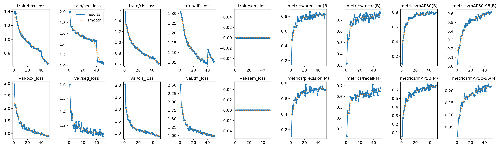 | 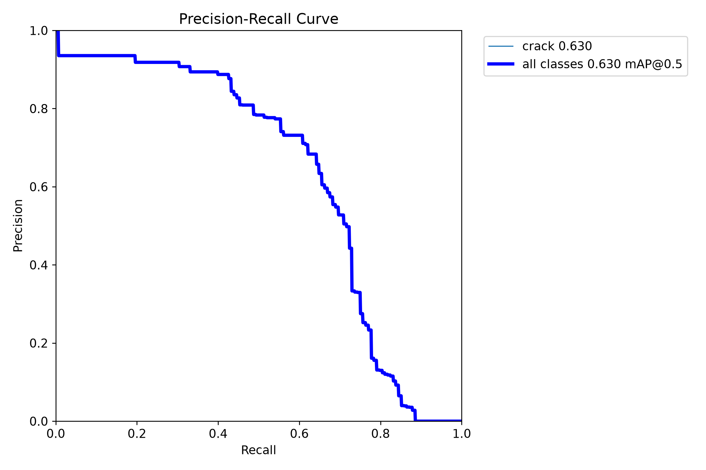 | 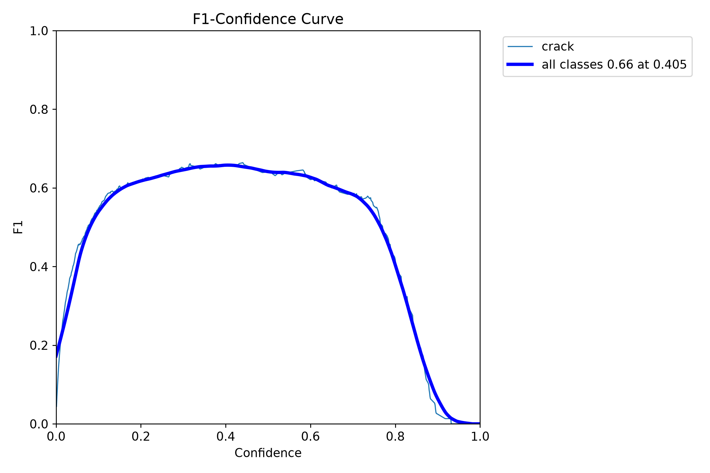 |

### Sample input → output (with damage estimate)
| | | | |
|---|---|---|---|
| 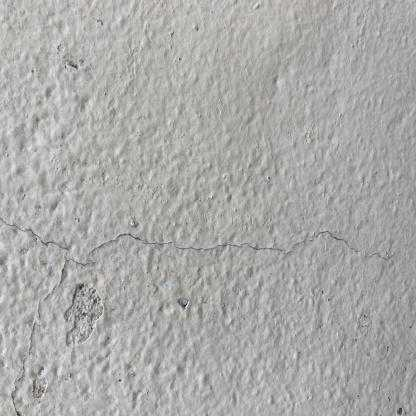 | 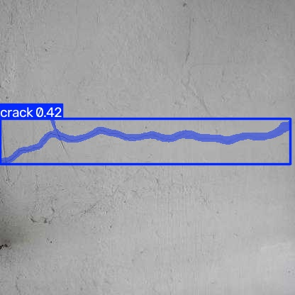 | 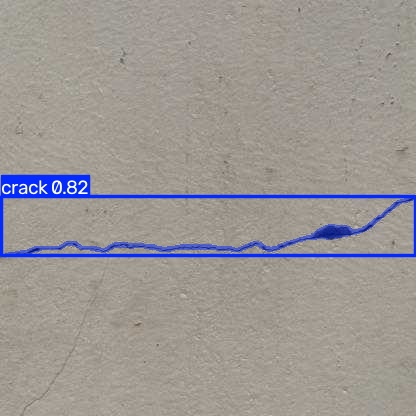 | 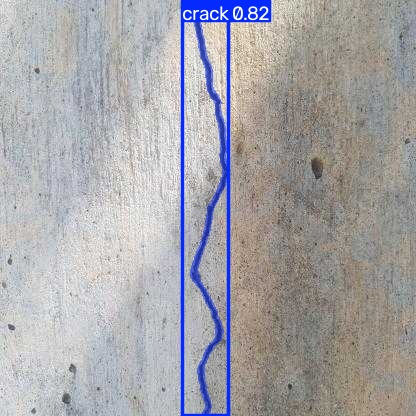 |
|  | 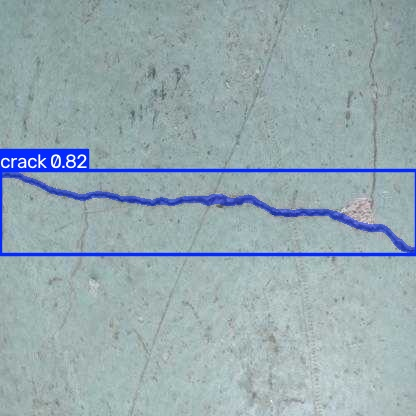 | 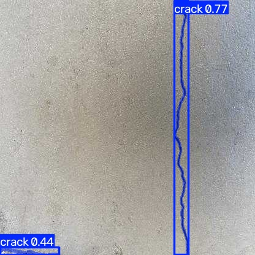 | 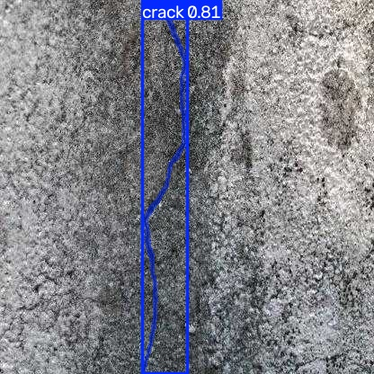 |

Estimated damaged area per sample (from the predicted masks) is stored in
[`results/metrics.json`](results/metrics.json) → `sample_damage_estimate` (≈ 1.3–1.8 % of the image).

Augmented training batch: [train_batch0.jpg](results/train_batch0.jpg)

## Limitations / Challenges
- **Thin structures:** pixel-accurate masks of hairline cracks are hard; masks tend to be slightly too thick.
- **Branching cracks** are sometimes split into several instances or partly missed (recall 0.61 for masks).
- **Confusing textures:** stains, joints, shadows and rough concrete can look like cracks.
- Damaged-area % is relative to the image, not a real-world size — a calibrated camera (known distance /
  scale) is needed to measure crack width in millimetres, which is what engineers actually use.
- The test split is small (112 images), so metrics have some uncertainty.

## Conclusion
A small YOLO11n-seg model finds cracks with **0.73 box mAP@0.5** and **0.63 mask mAP@0.5** at under 2 ms per
image, and its masks give a direct estimate of damaged area. This makes fast, automatic screening of walls,
floors and roads possible; precise crack-width measurement would need higher-resolution input and camera
calibration.

## How to run
```bash
pip install -r requirements.txt
python src/main.py          # downloads data, trains, evaluates, writes results/
```
See [report.md](report.md) for the brief project report.
