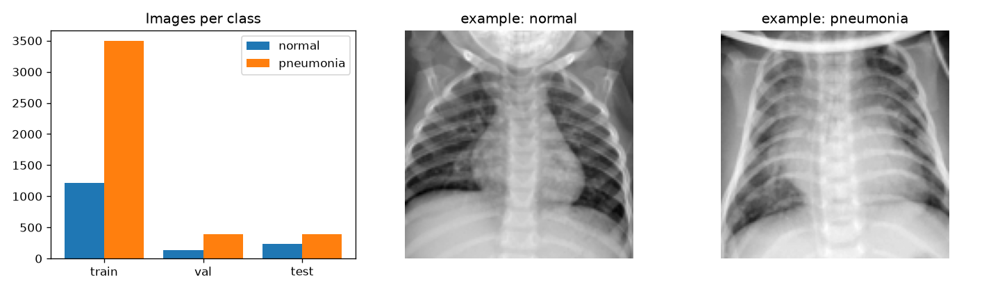
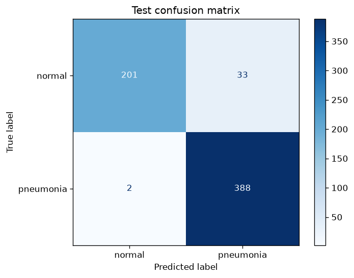
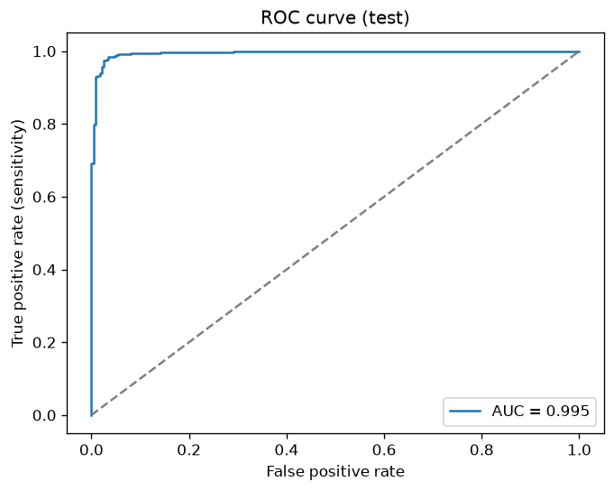
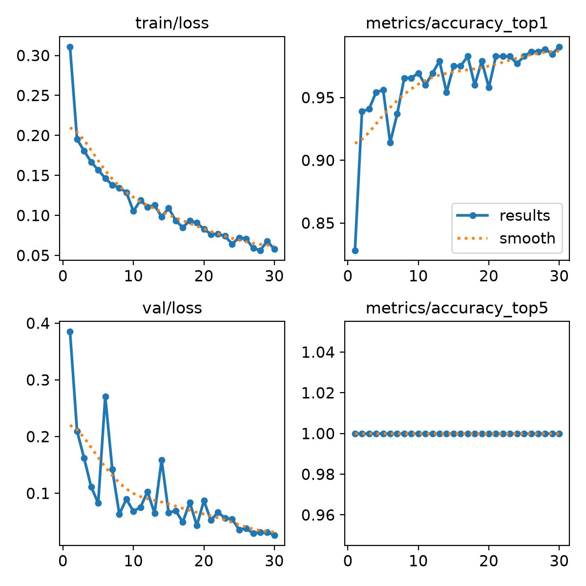
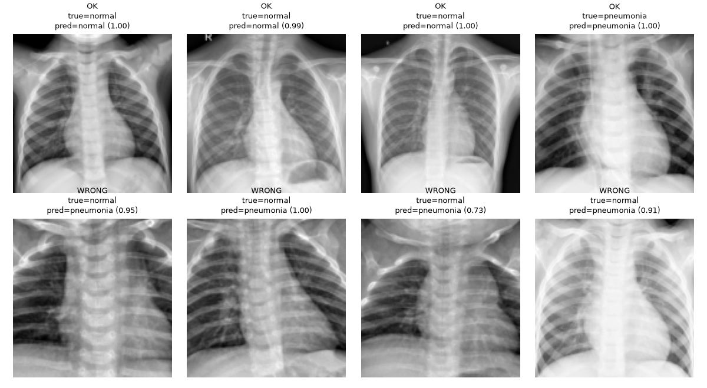

# Medical Image Classification and Analysis — Pneumonia Detection from Chest X-rays

**CV concept:** Image classification (one label per image) with transfer learning, evaluated with clinical metrics.



## Problem Statement
Pneumonia is a leading cause of death in children worldwide. Diagnosis relies on chest X-rays read by
radiologists, who are scarce in many hospitals. An automatic screening tool can flag likely pneumonia cases so
they are reviewed first.

## Objective
Build a classifier that labels a paediatric chest X-ray as **normal** or **pneumonia**, with very high
**sensitivity** (missing a sick patient is the most costly error), and analyse where it fails.

## Dataset
| | |
|---|---|
| Name | PneumoniaMNIST (MedMNIST v2/v3), 128×128 version |
| Link | https://medmnist.com/ · original data: Kermany et al., *Cell* 2018 |
| Classes | 0 = normal, 1 = pneumonia |
| Split | train 4708 (1214 normal / 3494 pneumonia) · val 524 · test 624 (234 / 390) |
| Download | automatic via the `medmnist` package on first run |

The dataset is **imbalanced** (≈ 3 pneumonia : 1 normal in training), so accuracy alone is not enough —
sensitivity, specificity and ROC-AUC are reported.

## Methodology
1. **Data preparation** — download the `.npz` arrays and write them as `split/class/*.png` folders (the format
   YOLO-cls expects) — `prepare_dataset`.
2. **Analysis** — class counts per split and example images — `analyse_dataset`.
3. **Preprocessing** — grayscale X-rays converted to 3 channels, resized to 128×128, normalised.
   **Augmentation:** random flips, scale and brightness changes, random erasing.
4. **Model** — YOLO11n-cls (CNN classifier, ImageNet-pretrained) fine-tuned for 30 epochs, batch 64.
5. **Evaluation** — on the untouched test split: accuracy, sensitivity (recall of pneumonia), specificity,
   precision, F1, ROC-AUC and confusion matrix (scikit-learn).

## Tools / Libraries Used
Python 3.11, PyTorch 2.11, Ultralytics YOLO11-cls, medmnist, scikit-learn, Matplotlib, Pillow.

## Results

### Performance evaluation (test split, 624 images)
| Metric | Value |
|---|---|
| Accuracy | **94.4 %** |
| Sensitivity (pneumonia recall) | **99.5 %** — only 2 of 390 pneumonia cases missed |
| Specificity (normal recall) | **85.9 %** |
| Precision (pneumonia) | 92.2 % |
| F1 (pneumonia) | 0.957 |
| ROC-AUC | **0.995** |
| Inference speed | 0.2 ms / image |

Confusion matrix (rows = true, columns = predicted):

| | pred normal | pred pneumonia |
|---|---|---|
| **normal** | 201 | 33 |
| **pneumonia** | 2 | 388 |

| Confusion matrix | ROC curve | Training curves |
|---|---|---|
|  |  |  |

### Sample input → output (top: correct, bottom: errors)


## Limitations / Challenges
- **Class imbalance** pushes the model towards "pneumonia": almost all errors are normal X-rays flagged as
  pneumonia (33 false positives). For screening this is the safer direction, but it creates extra work.
- The **ROC-AUC of 0.995** shows the model separates the classes very well — moving the decision threshold
  above 0.5 would raise specificity with little loss of sensitivity.
- 128×128 images lose fine detail that radiologists use.
- Data comes from **one hospital** (children aged 1–5); performance on adults or other X-ray machines is unknown.
- A screening aid only — not a diagnostic device; needs clinical validation.

## Conclusion
A fine-tuned YOLO11n-cls classifier detects pneumonia with **99.5 % sensitivity** and **0.995 ROC-AUC** on
unseen X-rays. The main remaining issue is false alarms on normal X-rays caused by class imbalance, which could
be reduced with threshold tuning, class weighting or more normal examples.

## How to run
```bash
pip install -r requirements.txt
python src/main.py          # downloads data, converts it, trains, evaluates, writes results/
```
See [report.md](report.md) for the brief project report.
