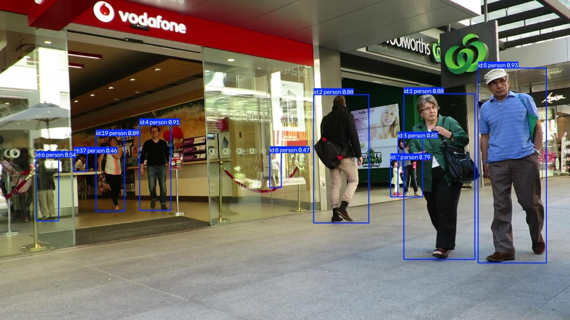
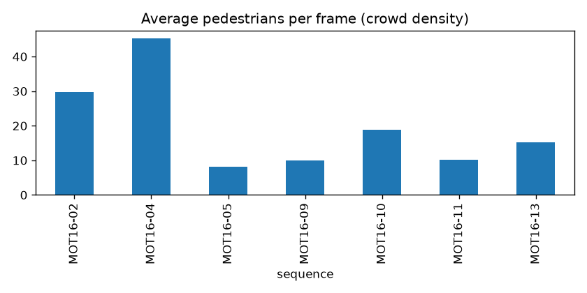
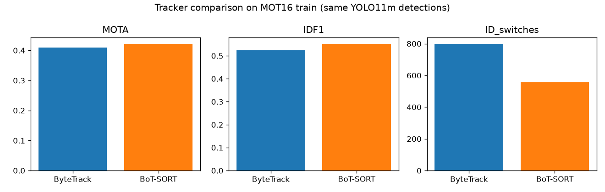
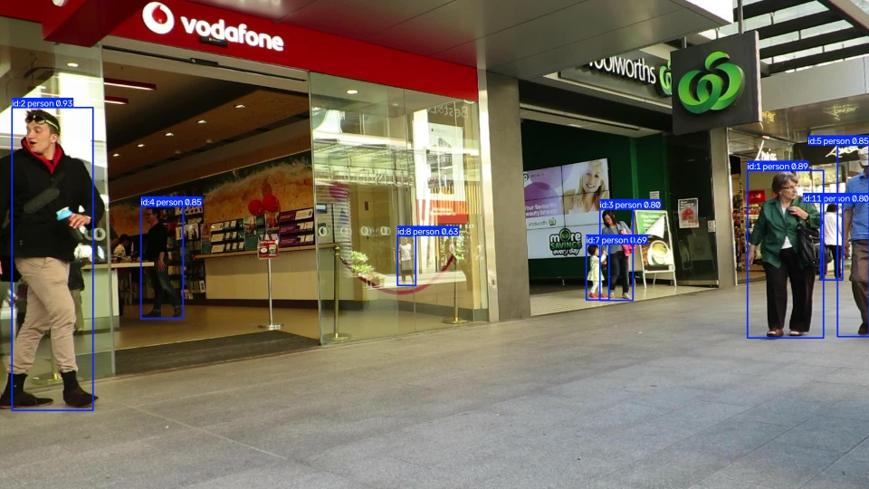
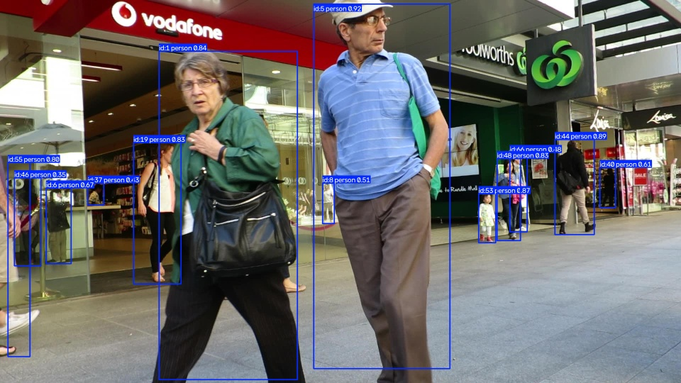

# Multi-Object Tracking System — Pedestrian Tracking on MOT16

**CV concept:** Multi-object tracking (tracking-by-detection): detect every person in each frame, then link the
detections over time so each person keeps a unique ID. Two trackers are compared.



## Problem Statement
Robots, surveillance systems and self-driving cars need to know not only *where* people are in one image but
*who is who* over time — to follow a person, count people, or predict where they will walk. Detection alone
gives no identity; a tracker must keep IDs consistent through occlusions and crowds.

## Objective
Build a real-time pedestrian tracking pipeline, evaluate it with the standard MOTChallenge metrics
(MOTA, IDF1, ID switches) and compare two modern trackers — **ByteTrack** and **BoT-SORT** — using exactly the
same detector.

## Dataset
| | |
|---|---|
| Name | MOT16 (MOTChallenge) |
| Link | https://motchallenge.net/data/MOT16/ |
| Used | the 7 **train** sequences (the only ones with public ground truth) |
| Size | 5316 frames, 517 pedestrian identities, 110k ground-truth boxes |
| Ground truth | `gt/gt.txt`: frame, id, x, y, w, h, consider-flag, class, visibility (pedestrians = class 1) |

```bash
# download (1.9 GB) — not stored in this repo
mkdir -p datasets && cd datasets
wget https://motchallenge.net/data/MOT16.zip && unzip MOT16.zip -d MOT16
```

| Sequence | Frames | Pedestrians | Avg people / frame |
|---|---|---|---|
| MOT16-02 | 600 | 54 | 29.7 |
| MOT16-04 | 1050 | 83 | 45.3 |
| MOT16-05 | 837 | 125 | 8.1 |
| MOT16-09 | 525 | 25 | 10.0 |
| MOT16-10 | 654 | 54 | 18.8 |
| MOT16-11 | 900 | 69 | 10.2 |
| MOT16-13 | 750 | 107 | 15.3 |



## Methodology
1. **Dataset analysis** — frames, identities and crowd density per sequence (`analyse_dataset`).
2. **Detection** — YOLO11m pretrained on COCO, keeping only the `person` class, confidence ≥ 0.3,
   input size 1280 (large input helps with small, distant pedestrians). No retraining.
3. **Tracking** (Ultralytics implementations):
   - **ByteTrack** — Kalman-filter motion prediction + IoU matching; also re-uses *low-confidence* detections
     in a second matching round to keep tracks alive through partial occlusion.
   - **BoT-SORT** — ByteTrack idea + camera-motion compensation (global motion estimation between frames),
     which keeps predictions correct when the camera moves.
4. **Evaluation** — `py-motmetrics`: each predicted box is matched to ground truth at IoU ≥ 0.5 per frame, then
   CLEAR-MOT and identity metrics are computed per sequence and overall.
5. **Visualisation** — tracked video and sample frames with ID labels, tracker comparison chart.

## Tools / Libraries Used
Python 3.11, PyTorch 2.11, Ultralytics YOLO11 (+ ByteTrack / BoT-SORT), py-motmetrics, OpenCV, pandas, Matplotlib.

## Results

### Performance evaluation (MOT16 train, all 7 sequences)
| Metric | ByteTrack | BoT-SORT | Better |
|---|---|---|---|
| **MOTA** ↑ | 40.9 % | **42.2 %** | BoT-SORT |
| **IDF1** ↑ | 52.3 % | **55.2 %** | BoT-SORT |
| ID switches ↓ | 799 | **557** | BoT-SORT |
| Mostly tracked ↑ | 131 | **151** | BoT-SORT |
| Mostly lost ↓ | 136 | **124** | BoT-SORT |
| False positives ↓ | **15 573** | 15 881 | ByteTrack |
| Misses ↓ | 48 843 | **47 391** | BoT-SORT |
| Speed (FPS) ↑ | **33.2** | 18.1 | ByteTrack |

*Metrics:* **MOTA** = 1 − (misses + false positives + ID switches) / ground-truth boxes;
**IDF1** = how consistently the same ID is kept on the same person; **ID switch** = a person's ID changes.
Per-sequence tables: [ByteTrack](results/per_sequence_ByteTrack.txt) · [BoT-SORT](results/per_sequence_BoT-SORT.txt).



**Where does BoT-SORT help?** Its IDF1 gain is largest on moving-camera sequences — MOT16-10 (+11.8 points),
MOT16-13 (+6.6), MOT16-05 (+3.3) — and near zero or negative on static-camera ones (MOT16-09: −2.2), which is
exactly what camera-motion compensation should do.

### Sample input → output
Demo video (MOT16-09, ByteTrack, first 200 frames): [results/demo_tracking.mp4](results/demo_tracking.mp4)

| Frame 20 | Frame 100 | Frame 180 |
|---|---|---|
|  |  |  |

## Limitations / Challenges
- **Misses dominate the error** (~47k missed boxes vs ~16k false positives): small, far-away and heavily
  occluded people in crowded scenes (MOT16-04 has 45 people per frame) are not detected. The tracker cannot
  track what the detector does not see. Fine-tuning the detector on pedestrian data (e.g. MOT17/CrowdHuman)
  would raise MOTA the most.
- The evaluation is simplified compared to the official MOTChallenge kit: ground-truth "distractor" classes
  (e.g. people on bikes, reflections) are dropped instead of ignored, so some correct detections count as
  false positives — real scores are slightly higher.
- Evaluated on train sequences because test ground truth is private; there is no training on MOT16, so this is
  still a fair zero-shot evaluation.
- FPS was measured while other models were training on the same GPU; standalone speed is higher.
- BoT-SORT's camera-motion compensation costs ~45 % speed — a trade-off between ID quality and real time.

## Conclusion
With the same YOLO11m detections, **BoT-SORT** keeps identities better (IDF1 55.2 % vs 52.3 %, 30 % fewer ID
switches) thanks to camera-motion compensation, while **ByteTrack** is almost 2× faster. For a moving robot
camera, BoT-SORT is the better choice; for a fixed camera with tight compute limits, ByteTrack is sufficient.
The biggest gain would come from a stronger pedestrian detector, since missed detections are the main error.

## How to run
```bash
pip install -r requirements.txt
# download MOT16 into datasets/MOT16 (see Dataset section), then:
python src/main.py
```
See [report.md](report.md) for the brief project report.
